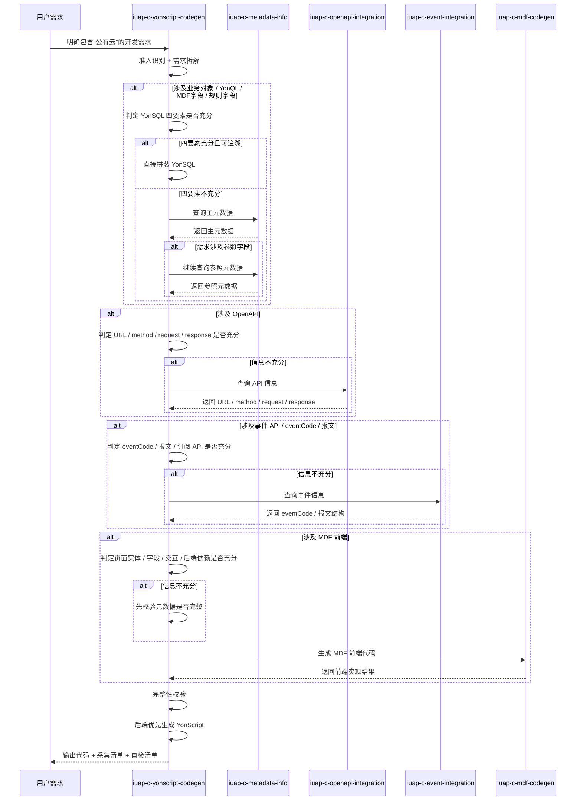

# 公有云项目整体编排

> **加载时机**：用户需求已命中“公有云项目域”，且准备执行代码生成、前后端联动、集成、规则、事件、API 等开发任务时。
> **职责**：统一规定公有云项目在本 skill 中的执行顺序：先拆解需求，后收集信息，再校验完整性，最后逐步生成代码。

---

## 1. 编排目标

本场景文档不是能力文档，而是**执行编排器**。

核心目标：

1. 先识别要交付什么。
2. 再识别缺什么信息。
3. 调用共用 skill 补齐信息。
4. 完整性校验通过后再生成代码。

---

## 2. 编排总流程

### 2.1 Mermaid 执行时序图



```text
公有云需求
  → 准入识别
  → 需求拆解
  → 信息采集
  → 完整性校验
  → 后端优先生成
  → 前端/联动补充生成
  → 输出契约检查
```

---

## 3. 阶段一：需求拆解

进入本 skill 后，先拆出以下维度：

- 是否需要 YonScript 后端
- 是否需要 MDF 前端
- 是否是前后端联动
- 是否涉及业务对象
- 是否涉及参照字段
- 是否涉及 OpenAPI
- 是否涉及事件 API
- 是否涉及 YonQL
- 是否涉及审批后/弃审后
- 是否涉及消息触达
- 是否涉及三方集成

建议生成内部任务清单：

```text
deliverables:
- backend_yonscript
- frontend_mdf

collectors:
- metadata_main
- metadata_ref
- openapi
- event_api

scenes:
- afterAudit
- integration
- mdf_linkage
```

---

## 4. 阶段二：信息采集

### 4.1 元数据采集

只要涉及以下任一项，且 YonSQL 四要素不充分，就必须先调用 `iuap-c-metadata-info`：

- YonQL
- 业务对象字段
- MDF 字段控制
- 保存校验
- 审批后反查
- 参照字段展示/翻译
- 子表/特征组
- 前后端字段映射

### 4.2 参照递归元数据采集

如果主元数据返回中，**需求涉及的字段是参照类型**，则必须继续查询该参照对象元数据。

触发场景：

- 需要 `code` / `name`
- 需要参照过滤
- 需要前端展示参照信息
- 需要后端翻译
- 需要 YonQL 关联
- 需要判断参照目标字段是否存在

执行规则：

```text
主对象元数据
  → 发现字段A为Reference
  → 若需求使用A的code/name/其他目标字段
  → 继续查询 A.refUri 对应元数据
```

### 4.3 OpenAPI 采集

只要涉及 API 且 URL / method / request / response 任一不明确，必须先调 `iuap-c-openapi-integration`：

- BIP OpenAPI
- 后端脚本调用接口
- 前后端联动依赖接口定义

禁止猜测：

- URL
- method
- request schema
- response schema

### 4.4 事件采集

只要涉及以下任一项，且 eventCode / 报文 / 订阅 API 信息任一不明确，必须先调 `iuap-c-event-integration`：

- 事件订阅
- 事件报文
- eventCode
- 事件 API

### 4.5 MDF 前端依赖采集

只要需求包含 MDF 页面扩展、字段控制、按钮事件、保存校验、前后端联动：

1. 先查业务元数据
2. 再判定页面实体 / 字段来源 / 交互方式是否充分
3. 不充分时再决定是否调用 `iuap-c-mdf-codegen`

注意：

- `iuap-c-mdf-codegen` 只负责前端实现
- 主编排权仍在本 skill

### 4.6 MDF 查询后端依赖识别

公有云 MDF 前端没有直接查询业务对象详情、跨对象查询、ID 转编码的稳定能力。若 MDF 需要调用 API 查询后再回填、跳转报表或补充页面参数，按需加载 `06_MDF前端联动API契约.md`，不要在整体编排文档中展开实现细节。

---

## 5. 阶段三：完整性校验

生成代码前，必须检查：

### 元数据完整性

- 主对象元数据是否齐全
- 子表是否齐全
- 特征组是否齐全
- 需求涉及的参照元数据是否已补齐

### API 完整性

- URL 是否已拿到
- method 是否已拿到
- request schema 是否已拿到
- response schema 是否已拿到

### 事件完整性

- eventCode 是否已拿到
- 报文结构是否已拿到

### 前端依赖完整性

- 字段来源是否明确
- 前后端交互方式是否明确

只要有一项未完成，禁止进入生成阶段。

---

## 6. 阶段四：逐步生成

### 6.1 后端优先

先生成 YonScript 后端：

- Rule 脚本
- API 脚本
- YonQL
- ObjectStore 调用
- 集成逻辑
- 事件逻辑
- 定时任务脚本

### 6.2 前端后置

如果需求涉及 MDF：

1. 先确保后端 API / 字段 / 事件依赖已明确
2. 再调用 `iuap-c-mdf-codegen` 生成前端部分

### 6.3 联动说明

最后补：

- 脚本编码
- 绑定位置
- 前后端调用链
- 元数据消费清单
- API 查询清单
- 事件查询清单

---

## 7. 与其他 skill 的协同边界

### 允许协同

- `iuap-c-metadata-info`
- `iuap-c-openapi-integration`
- `iuap-c-event-integration`
- `iuap-c-mdf-codegen`

### 禁止转交主实现

- `iuap-c-server-codegen`
- 任何 Java / 本地化后端 skill
- 任何业务集成代码生成 skill

原因：公有云项目域内，后端主实现必须收口到 `iuap-c-yonscript-codegen`。

---

## 8. 结果要求

本编排完成后，输出至少应覆盖：

1. 公有云项目域准入结论
2. 已完成的信息采集清单
3. 完整 YonScript 后端代码
4. 如有 MDF，则包含前端代码或前端交付说明
5. 元数据/API/事件依赖清单
6. 最终自检清单
