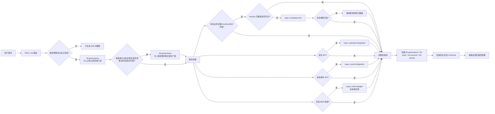
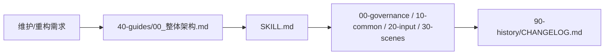

# iuap-c-yonscript-codegen 整体架构

> **用途**：定义本 skill 的整体分层、职责边界、加载顺序、维护约束。
> **加载时机**：维护 skill、自查结构、做架构改造、梳理文档职责时加载。
> **重要**：凡涉及目录分层、文档职责、加载链、主入口路由的调整，必须同步更新本文档和 `../90-history/CHANGELOG.md`。

---

## 1. 架构目标

本 skill 服务于**用友旗舰版公有云项目代码生成与统一编排**，核心目标不是“堆知识”，而是让 agent 能稳定地：

1. 先识别当前是否属于公有云项目域。
2. 再做需求拆解和信息采集。
3. 然后加载强制治理规则、通用能力、输入结构、场景编排。
4. 最后按准确依赖生成后端/前端代码。

因此本 skill 必须满足：

- 渐进式加载
- 单一权威来源
- 公有云项目首入口唯一编排器
- 场景编排与通用能力解耦
- 输入结构与业务规则解耦
- 历史记录与主加载链解耦

---

## 2. 总体分层

### 2.1 分层架构图

```mermaid
flowchart TD
    U[用户需求] --> S[SKILL.md 路由入口]

    S --> G[00-governance<br/>治理层]
    S --> C[10-common<br/>通用能力层]
    S --> I[20-input<br/>输入结构层]
    S --> N[30-scenes<br/>场景编排层]
    S --> D[40-guides<br/>指南层]
    S --> H[90-history<br/>历史层]

    G --> G1[技术规范]
    G --> G2[V8 沙箱安全模式]
    G --> G3[元数据门禁]
    G --> G4[输出契约]
    G --> G5[公有云项目域门禁]
     G --> G6[YonSQL 信息充分性门禁]
     G --> G7[协同能力信息充分性门禁]
     G --> G8[生成准确性保障 Evidence Gate]
     G --> G9[最新需求事实锁定门禁]

    C --> C1[代码框架]
    C --> C2[YonSQL<br/>类型识别/嵌套/特征]
    C --> C3[字段命名契约]
    C --> C4[Long 精度防御]
    C --> C5[远程调用]
    C --> C14[API脚本查询与日志模式]

    I --> I1[MDD 入参]
    I --> I2[YPD 入参]
    I --> I3[MDD 赋值]
    I --> I4[YPD 赋值]
    I --> I5[样本 JSON]

    N --> N0[公有云项目整体编排]
    N --> N1[审批后/弃审后反查]
    N --> N2[消息触达]
    N --> N3[三方集成封装]
    N --> N4[流程脚本]
    N --> N5[相关性规则]
    N --> N6[MDF联动API契约]

    D --> D1[整体架构]
    D --> D2[字段/场景对照]
    D --> D3[绑定指南]
    D --> D4[核心 API 速查]
    D --> D5[优化经验]

    H --> H1[CHANGELOG]
```



```text
SKILL.md
  └─ 路由与加载决策
     ├─ 00-governance   治理层
     ├─ 10-common       通用能力层
     ├─ 20-input        输入结构层
     ├─ 30-scenes       场景编排层
     ├─ 40-guides       指南层
     └─ 90-history      历史层
```

---

## 3. 分层职责

### 3.1 `SKILL.md`

职责：

- skill 触发词入口
- 边界说明
- 渐进式加载规则
- 场景路由
- 治理层前置要求

禁止：

- 禁止复制完整规范
- 禁止复制完整代码模板
- 禁止承载场景实现细节

### 3.2 `00-governance/`

职责：

- 定义所有生成前必须遵守的硬约束
- 提供统一输出契约
- 作为所有场景和通用能力的上游规则源

包含：

- `01_技术规范.md`
- `02_V8沙箱安全模式.md`
- `03_元数据门禁.md`
- `04_输出契约.md`
- `05_公有云项目域门禁.md`
- `09_最新需求事实锁定门禁.md`

特征：

- 强制加载
- 高稳定性
- 低频改动

`09_最新需求事实锁定门禁.md` 为条件强制门禁：生成前自动抽取最新业务事实并对比历史事实；发生事实漂移或准备复用旧代码时加载，用于让 agent 主动隔离历史噪音并重建事实锁。

### 3.3 `10-common/`

职责：

- 沉淀横向复用能力
- 不绑定具体业务场景
- 被多个场景文档依赖

典型能力：

- 代码框架
- YonSQL 类型识别、嵌套子查询、特征字段、平行表取数
- 字段命名契约
- Long 精度防御
- 远程调用
- 实体操作
- 加密、字符串、金额、随机码
- patterns
- API 脚本查询、返回结构、生产日志与 YonSQL 日期兼容模式

维护约束：

- 既有脚本的小范围修改边界属于治理层 V8 安全纪律，补丁边界前后三行必须保持原样；业务注释只能进入本次修改逻辑内部。
- 三方/NCC 调用编排属于场景层；如果现场已有统一 `extrequire` 封装，场景文档优先要求复用封装，远程调用通用层只保留基础 API 示例。

特征：

- 按需加载
- 单文档单能力主题
- 不重复治理层内容

### 3.4 `20-input/`

职责：

- 定义 MDD / YPD 的输入结构和赋值方式
- 解决“从哪取数据、如何回写数据”
- 不负责业务编排

包含：

- MDD 入参
- YPD 入参
- MDD 赋值
- YPD 赋值
- 原始样本 JSON

### 3.5 `30-scenes/`

职责：

- 负责具体场景编排
- 决定这个场景需要哪些治理层/通用层/输入层文档
- 描述执行步骤和组合关系

当前场景：

- 审批后/弃审后反查
- 公有云项目整体编排
- 消息触达
- 三方集成封装
- 流程脚本
- 相关性规则
- MDF 前端联动 API 契约

原则：

- 场景文档只做“编排器”
- 能力细节回跳到 `00-governance` / `10-common` / `20-input`

### 3.6 `40-guides/`

职责：

- 提供辅助理解材料
- 提供维护者视角的整体说明
- 不作为强制规则源

当前定位：

- `00_整体架构.md`：架构基线
- 字段/场景对照
- 绑定指南
- API 速查
- 优化经验

### 3.7 `90-history/`

职责：

- 只保留历史变更记录
- 不参与主加载链
- 提供维护追溯依据

---

## 4. 标准加载链

### 4.1 代码生成主链



```text
用户需求
  → SKILL.md 路由
  → 00-governance
  → 20-input（按脚本类型）
  → 10-common（按能力）
  → 30-scenes（按业务场景）
  → 40-guides（仅必要时）
  → 输出结果
```

### 4.2 维护改造主链



```text
维护需求
  → 40-guides/00_整体架构.md
  → SKILL.md
  → 00-governance / 10-common / 20-input / 30-scenes
  → 90-history/CHANGELOG.md
```

---

## 5. 依赖原则

允许依赖方向：

- `SKILL.md` → 任意层
- `30-scenes` → `00-governance` / `10-common` / `20-input` / `40-guides`
- `20-input` → `00-governance` / `10-common` / `40-guides`
- `10-common` → `00-governance` / 少量 `40-guides`
- `40-guides` → `00-governance` / `10-common` / `20-input` / `30-scenes`
- `90-history` → 可记录任意层历史

公有云项目域内允许的外部协同：

- `iuap-c-metadata-info`：只负责查元数据
- `iuap-c-openapi-integration`：只负责查 API
- `iuap-c-event-integration`：只负责查事件
- `iuap-c-mdf-codegen`：只负责前端实现

禁止依赖方向：

- `00-governance` 反向依赖 `30-scenes`
- `10-common` 反向依赖具体业务场景实现
- `20-input` 承载业务流程编排
- `90-history` 被主加载链依赖
- 公有云项目后端主实现转交给 Java / 本地化 / 业务集成后端生成 skill

---

## 6. 文档编写规范

### 治理层文档

- 写“必须/禁止/门禁/契约”
- 不写大段业务场景故事

### 通用能力文档

- 一个文档只解决一个能力主题
- 不重复路由和门禁

### 输入层文档

- 聚焦字段路径、样本结构、赋值方式
- 不写完整业务编排

### 场景层文档

- 固定写法：触发词、加载依赖、执行步骤、输出要求、禁止事项
- 不重复通用能力实现

### 指南层文档

- 做辅助说明，不做唯一约束
- 可以有总览、对照、经验总结

---

## 7. 变更维护规则

### 必须同步更新架构文档的情况

- 调整目录分层
- 调整任意文档职责边界
- 修改 `SKILL.md` 的主路由逻辑
- 新增或删除一个核心场景层文档
- 新增治理层门禁
- 将某个能力从场景层抽到通用层，或反向合并
- 调整公有云项目域准入规则
- 调整信息采集顺序、完整性校验规则、外部协同边界

### 必须同步更新 CHANGELOG 的情况

- 任何文件移动、重命名、删除、分层重构
- 治理层规则变化
- 场景路由变化
- 关键规范变化

### 推荐记录格式

1. 版本号
2. 日期
3. 改动范围
4. 概要
5. 设计原则/影响面

---

## 8. 后续演进建议

如果后续场景继续增多，建议保持以下策略：

1. 新能力优先落 `10-common/`
2. 新场景优先落 `30-scenes/`
3. 只有“所有场景都必须先看”的规则，才进入 `00-governance/`
4. 原始样本和结构数据只放 `20-input/samples/`
5. 架构变化先改本文档，再改实现文档，再补 changelog

---

## 9. 当前架构基线

当前版本的架构基线是：

- 只要命中“公有云项目”，就必须优先进 `iuap-c-yonscript-codegen`
- `iuap-c-yonscript-codegen` 是公有云项目域的唯一后端编排器和唯一后端实现入口
- `00-governance` 负责硬约束、公有云域门禁、YonSQL 信息充分性门禁、查询形态契约；高噪音场景还负责自动事实漂移检测、事实锁定和历史噪音隔离
- `10-common` 负责通用能力
- `20-input` 负责入参/赋值
- `30-scenes` 负责业务场景编排与整体执行顺序
- `40-guides` 负责辅助说明和整体架构
- `90-history` 负责历史记录

后续如有架构改造，必须先更新本文件。
